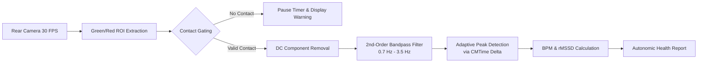

# HealthScan 🫀

> **Privacy-first, 100% offline cardiovascular & autonomic nervous system vitals scanner powered by on-device Photoplethysmography (PPG).**

HealthScan turns your iPhone's rear camera and LED flash into an optical plethysmograph. By transilluminating capillary blood beds in the fingertip, HealthScan computes real-time cardiovascular telemetry—including **Resting Heart Rate (BPM)**, **Heart Rate Variability (HRV rMSSD)**, **Stress Score**, **Respiratory Rate**, and **Autonomic Readiness**—with zero network requests, zero telemetry, and zero third-party dependencies.

---

## 📸 Overview & Key Features

- **🔬 Real-Time Optical PPG Engine:** Extracts micro-vascular volumetric pulsations by tracking green/red channel optical absorption at 30/60 FPS via AVFoundation.
- **⚡ Advanced Digital Signal Processing (DSP):** Dual-pass bandpass filtering (0.7 Hz – 3.5 Hz, ~42–210 BPM) paired with adaptive peak detection and sub-millisecond `CMTime` inter-beat interval (IBI) calculation.
- **📊 Biomarker Suite:**
  - **Heart Rate (BPM):** Average and instantaneous pulse rate.
  - **HRV (rMSSD in ms):** Root Mean Square of Successive Differences for autonomic nervous system (vagal tone) tracking.
  - **Stress Score (1–100):** Inverted autonomic stress index derived from HRV parasympathetic modulation.
  - **Respiratory Rate (BrPM):** Derived from respiratory sinus arrhythmia (RSA) modulation of pulse amplitude and timing.
  - **Readiness Score (1–100):** Recovery and vitality rating calibrated against resting baselines.
- **🩺 Dual-Audience Clinical Report Generator:** 
  - **Physician-Grade Telemetry:** Objective cardiovascular metrics, baseline deviations, and rhythm notes.
  - **Empathetic Human Recommendations:** 3 actionable, kind, jargon-free health suggestions tailored to user context.
- **🏷️ Context-Aware Baseline Tagging:** Categorize readings (*Resting, Post-Workout, Stressed, Morning, Walking, Deep Focus*) with dynamic thresholding and adaptive analysis.
- **🛡️ Hardware-Safe Transducer Layer:**
  - **Thermal State Guard:** Active thermal polling and notification observation (`ProcessInfo.thermalState`); halts or prevents sessions if the device reaches serious or critical thermal levels.
  - **Dimmed Torch Power:** Regulates LED brightness to $\le 0.15$ lux to prevent finger discomfort and sensor burn.
  - **Dynamic Exposure & White Balance:** Dynamic convergence and lock/unlock cycle preventing overexposure or room light contamination.
  - **Contact & Capillary Blanching Detection:** Real-time optical ratio check (`avgRed > 80 && avgRed > avgGreen * 1.15`) with persistent HUD guidance and automatic countdown pause/resume.
- **🔒 Zero-Knowledge Privacy:** Completely offline. Built with no networking frameworks (`URLSession`, `Alamofire`, or analytics SDKs). All data stays in your sandboxed device storage.

---

## 🛠️ Architecture & Tech Stack

```
HealthScan/
├── API/             # Offline mock / contract definitions
├── Capture/         # AVFoundation camera pipeline, frame delegate, DSP filters, thermal guards
├── Models/          # @Observable models, HealthReportGenerator, Biomarkers, Contact state
├── Notifications/   # Local notification reminders
├── Storage/         # MeasurementStore (JSON persistence), HealthKit integration
└── Views/           # SwiftUI views, components, real-time waveform canvas, reports
```

- **Language:** Swift 6 (Strict Concurrency checking enabled)
- **UI Framework:** SwiftUI (Declarative, `@Observable` state, AppTheme design system tokens)
- **Signal Processing:** Accelerate framework / custom DSP pipeline with `CMTime` hardware timestamps
- **Target OS:** iOS 17+ (Designed for iOS 26+ modern APIs)
- **Architecture:** Clean MVVM + Service Layer, strictly enforcing modular file limits ($\le 200$ lines/file)

---

## 🚀 Getting Started

### Prerequisites

- A Mac running **macOS Sonoma / Sequoia** or later.
- **Xcode 16+** with the iOS SDK installed.
- **A physical iPhone** with a rear camera and LED flashlight (camera PPG requires physical optical transillumination; the iOS Simulator will run with synthetic mock waveform data for UI testing).
- An Apple Developer Account (free or paid) for deploying to hardware.

### Installation

1. **Clone the repository:**
   ```bash
   git clone https://github.com/your-username/HealthScan.git
   cd HealthScan
   ```

2. **Open in Xcode:**
   ```bash
   open HealthScan.xcodeproj
   ```

3. **Configure Code Signing:**
   - In Xcode, select the top-level **HealthScan** project in the Project Navigator.
   - Go to **Signing & Capabilities**.
   - Under **Team**, select your Apple ID or Developer Team.
   - Ensure the Bundle Identifier is unique.

4. **Run on a Physical iPhone:**
   - Connect your iPhone via USB-C / Lightning or wireless debugging.
   - On your iPhone, enable **Developer Mode**:
     `Settings > Privacy & Security > Developer Mode > On` (device restart required).
   - In Xcode's destination dropdown, choose your connected physical iPhone.
   - Press **⌘R** (Run) to build, sign, and install.

---

## 📖 How to Take a Measurement

1. Open **HealthScan** and tap **Start Measurement**.
2. Rest your index finger gently across the **rear camera lens and the LED flashlight**.
   > **Tip:** Do not press too hard! Excessive pressure blanches your capillaries and cuts off pulsatile blood flow.
3. HealthScan will detect contact and begin the countdown:
   - If contact is lost or pressure is uneven, the app displays a persistent alert banner and automatically pauses the timer.
   - Once contact is restored, the countdown resumes seamlessly.
4. Keep still for the duration of the scan (~20–30 seconds) while breathing normally.
5. Review your **Heart Rate, HRV, Stress, and Readiness Scores**, read your personalized health report, tag your activity, and save the session to your history.

---

## 🧮 Signal Processing Pipeline



1. **ROI Extraction:** Average green and red channel intensities are computed per frame. While red transilluminates tissue, the green spectrum exhibits the highest differential absorption by oxygenated hemoglobin ($\text{HbO}_2$).
2. **Contact Validation:** Evaluates luminosity thresholds and color ratios to verify that human tissue completely seals the optical path before feeding samples to the filter.
3. **Bandpass Filtering:** Strips high-frequency sensor noise and low-frequency motion baselines, preserving physiological frequencies ($42–210\text{ BPM}$).
4. **Hardware-Accurate HRV:** Rather than assuming a constant frame rate, inter-beat intervals (RR-intervals) are measured using native camera presentation timestamps (`CMSampleBufferGetPresentationTimeStamp`), ensuring jitter-free rMSSD computation:
   $$\text{rMSSD} = \sqrt{\frac{1}{N-1} \sum_{i=1}^{N-1} (RR_{i+1} - RR_i)^2}$$

---

## ⚖️ Medical Disclaimer

> **IMPORTANT:** HealthScan is designed strictly for personal wellness, fitness, and informational purposes. It is **not** a certified medical device and is not intended to diagnose, treat, cure, or prevent any medical condition, cardiovascular disease, or arrhythmia. Never disregard professional medical advice or delay seeking treatment based on readings from this application.

---

## 📄 License

This project is licensed under the [MIT License](LICENSE) — feel free to use, modify, and build upon it.
